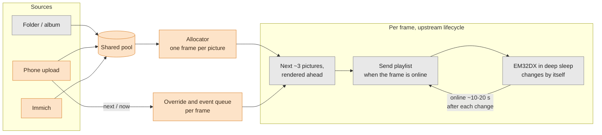
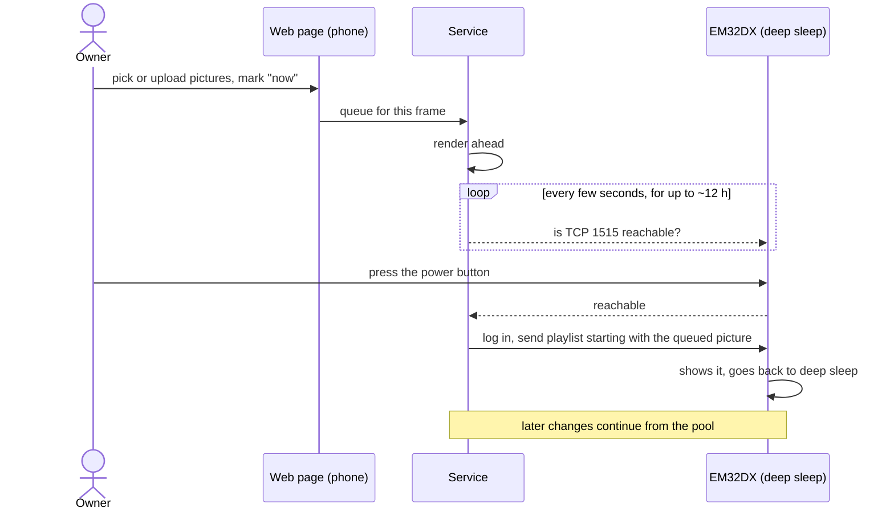

# EMDX photo frame

## About this fork

This is a fork of [jdemeul/emdx-photo-frame](https://github.com/jdemeul/emdx-photo-frame), by Jonas Demeulemeester, MIT licensed. Everything from [the upstream description](#what-upstream-does) on is upstream's documentation and still describes how the service works today. This section covers only what differs here: why the fork exists, what it has changed so far, and what it plans to add.

### Why a separate repository

Upstream looks after each frame on its own. Every frame gets its own album, its own shuffle round and its own playlist. We want to run three to five EM32DX frames on battery from **one shared pool of pictures**, and that changes the part of the service that decides which picture goes where:

- **No picture on two frames at once.** Pictures come from one pool, and a picture belongs to one frame for as long as that frame might still show it.
- **"Show this next" and "show this now".** Pick or upload pictures on a phone, then press the frame's button. The service waits for the frame to come online and sends them straight away.
- **Event mode.** A temporary set of pictures in a fixed order, for example for a birthday, after which the frame goes back to the pool.
- **Upload from a phone**, and later pictures from Immich.

A clean rewrite would have to port the device handling as well: deep sleep, waking up after a change, the fresh playlist after every change that keeps the EM32DX from getting stuck, restart recovery, and the tests with a fake display. Upstream worked all of that out on a real EM32DX ([findings](docs/findings.md)), and its tests cover it against a fake display. So we keep that part unchanged and add new modules around the picture selection. We also need our own container image for our Kubernetes deployment.

We merge upstream changes from the `upstream` remote from time to time. Generic fixes can be offered back.

### Status

| Change | Status |
| --- | --- |
| Tests and container image build on pull requests and pushes to `main`; a `vX.Y.Z` tag publishes `ghcr.io/beastyrabbit/emdx-photo-frame:X.Y.Z` ([workflow](.github/workflows/release-image.yaml)) | done, `v1.0.0` (upstream code unchanged) |
| This section, `AGENTS.md`, lefthook with gitleaks | done |
| Hardware check of the unchanged upstream: one week of daily changes in deep sleep, then every 48 and 72 hours, with battery readings and photos of the panel | running since 18 November 2026 |
| Shared pool with no duplicates across frames | planned |
| Next/now override, delivered when the button wakes the frame | planned |
| Event mode | planned |
| Upload from a phone | planned |
| Change every N days (a cron step such as `*/2` restarts at each month's end) | planned |
| Immich as a picture source | planned |
| New web page, phone first: settings change at the frame's next wake or at once after a button press | in progress |
| Samsung "Custom App" content source (our own app on the frame) | tested 19 November 2026 and shelved: the frame installs only Samsung-signed packages. Frames on mains power use the normal "Mobile" source with network standby on instead. |

The planned items wait for the hardware check and for a written extension design. Their exact shape may still change.

### How the planned flow differs

Upstream today, per frame: an album or folder feeds that frame's shuffle round, the service renders the next days and sends them as the display's own playlist, the display changes the picture by itself, and right after each change, while it is briefly online, it gets a fresh playlist.

The fork keeps that device cycle (grey below) and puts a shared pool, an allocator and an override queue in front of it (orange):



The override path is the main new behaviour. Today a picture for a sleeping frame waits for its next scheduled change. In the fork it goes out the moment someone presses the frame's button:



### Working on this fork

See [AGENTS.md](AGENTS.md).

## What upstream does

A small service for a NAS that shows a different photo every day from a shared Google Photos album on a Samsung EMDX colour e-paper display. It picks the photo, crops it for the frame and sends it to the display over the network. In playlist mode it sends weeks of photos at once and the display changes them itself, so it can stay in deep sleep in between. A web page on the NAS shows what is on the frame and what comes next.

It runs as a single Docker container. It was written for a Synology NAS (a DS420+, with a 32" EM32DX hung in portrait), but any always-on Docker host on the same network as the display will do.

- **Shuffle without repeats:** every photo in the album is shown once before anything repeats. Photos added to the album later join the current round.
- **Odd shapes get paired:** on a portrait frame, landscape and square photos are shown two at a time, preferably two taken around the same time. Portrait photos fill the frame, smart-cropped around the most interesting part.
- **People stay in the picture:** the NAS finds the faces in each photo and places the crop around them. A group that is wider than the crop is cropped less, with a white band, so nobody is cut off.
- **The display does the final dithering:** the NAS crops and tones the photo, and the panel's own algorithm turns it into ink dots. A NAS-side ditherer is included as `DITHER=local`, but on the EM32DX the panel's own processing looked better.
- **Deep sleep between photos:** in playlist mode the display changes the photo itself every night and sleeps deeply in between. It comes online briefly after each change, and that is when the NAS checks the battery and sends the next batch of photos.
- **Several frames:** one service can look after more than one display, each with its own settings, album round and page.
- **Pictures from a prompt:** describe a picture on the web page and Google's image model draws it for the frame, as a one-off or to keep among the album's photos (optional; needs a Google API key).
- **Public-domain art:** search a catalogue of paintings, prints and posters on the web page and put one on the frame, keep it among the photos, or let the frame bring a masterpiece by itself every few days. Shown whole, with its title and artist under it.

What we found out about the EM32DX along the way (sleep, wake-up, playlists, dithering): [docs/findings.md](docs/findings.md).

## 1. What you need

| | Where to find it |
|---|---|
| **Album share link** | Google Photos → the album → Share → *Create link*. It looks like `https://photos.app.goo.gl/…` (the full `https://photos.google.com/share/…?key=…` address works too). Anyone with this link can view the album. |
| **Display IP address** | Router or the Samsung E-Paper app. Give the display a fixed DHCP lease. |
| **Display PIN** | The 6-digit device security PIN you set when configuring the display in the Samsung E-Paper app. |
| **Display MAC address** | Router or app. Only needed for Wake-on-LAN (`SLEEP_MODE=standby`). |
| **NAS IP address** | DSM → Control Panel → Network. |

On the display (Samsung E-Paper app), set **Screen Orientation** to match how it hangs (`.env.example` assumes portrait).

## 2. Install on a Synology NAS (Container Manager)

1. Copy this folder to the NAS, e.g. `/volume1/docker/emdx-photo-frame` (File Station, a mapped drive, or `git clone`).
2. In that folder, copy `.env.example` to `.env` and fill in `ALBUM_URLS`, `EMDX_HOST`, `EMDX_PIN` and `SERVER_HOST`.
3. DSM → **Container Manager** → **Project** → **Create**. Choose the folder; it picks up `docker-compose.yml`. Let it build and start; the first build takes a few minutes. (Over SSH instead: `cd /volume1/docker/emdx-photo-frame && sudo docker compose up -d --build`.)
4. If the DSM firewall is on, allow TCP **8321** from your LAN: the display downloads the photos from it.

The container uses host networking and restarts automatically. Its state (which photos were shown, the planned photos, history) lives in a Docker volume, `frame-data`, so updating by copying a new version of the folder over the old one keeps it. To start over, stop the project and delete the volume over SSH (`sudo docker volume ls` shows its name, ending in `frame-data`; `sudo docker volume rm <name>` removes it).

## 3. First run

Open `http://<NAS-IP>:8321` and press the display's power button to wake it.

1. Press **Show test pattern** and walk over to the display; the panel takes 20–50 s to redraw. **"▲ TOP"** must be at the top with all four corner marks visible: if not, set `ROTATE=90`, `180` or `270` in `.env` and restart the project. The six swatches should be the six inks, and the two sets of colour bands compare the NAS ditherer with the display's own (**"Smooth"**, the default `DITHER=device`).
2. Press the power button again if the display has gone back to sleep, then **Send playlist** (playlist mode) or **Next photo now** (push mode).
3. In playlist mode, the **Playlist** tab shows the coming days. At the next `SCHEDULE` time the frame should change to the next photo by itself, and **After a change** shows that the display came online right after it.

## 4. How the photo changes

### Playlist mode (`UPDATE_MODE=playlist`, best on battery)

Use it with `SLEEP_MODE=deep`.

- The NAS renders the photos for the coming `PLAYLIST_DAYS` (default 7, up to 60) and sends them as the display's own playlist: the photo for now until the next `SCHEDULE` time, then one photo per change. The display changes the photo by itself and sleeps in between, with its Wi-Fi off.
- After each change the EM32DX comes online briefly. The NAS looks for it then (for up to `WAKE_WINDOW_MIN`), reads its battery and sends it a fresh playlist straight away, from the photos that are ready; the display then goes back to sleep by itself. No button presses needed.
- **Why a fresh playlist after every change** (`PLAYLIST_RESEND=every-change`, the default): on battery, an EM32DX that was left alone after a change got stuck in its panel cleaning before the next one, the panel a solid yellow, every time (8 to 14 November 2026: the first change after a playlist always worked, the second never). With a fresh playlist after every change it changed every morning; see [findings](docs/findings.md). `PLAYLIST_RESEND=when-short` sends one only once fewer than `PLAYLIST_TOPUP_DAYS` days are left: fewer downloads, for a display that doesn't have this problem (on USB-C power, say).
- **Did it change?** The NAS can't see the panel, so a change counts as made when the display came online after it: a good sign, not proof. (The EM32DX only sends a thumbnail of its screen over HTTPS, to a server it trusts; see [findings](docs/findings.md).)
- If the display doesn't come online after a change, it has probably slept through it (or hung in its panel cleaning) and still shows the photo before. The NAS then looks for it every `MISSED_CHECK_SEC` (60) seconds, without waking it, and sends a fresh playlist as soon as it answers, so a press on its power button is all it takes.
- **Panel cleaning:** the display cleans its panel once a day (the *screen protection* time in the Samsung E-Paper app; it can be moved, not switched off). Set it to just before the change, e.g. 05:50 for a 06:00 change: with it at night, an EM32DX on battery slept through most morning changes. The NAS reads the time from the display (or `CLEANING_TIME`) and leaves the display alone from 15 minutes before the cleaning until 30 minutes after.
- A fresh playlist starts with the photo already on the frame, so nothing changes on screen. If none arrives in time, the display starts its playlist over, still at the change times. Changes follow `SCHEDULE` in your time zone, also across daylight-saving switches.
- **How long a playlist?** Each photo goes to the display as a full-colour PNG of typically 2–4 MB, and the EM32DX downloads about two a second, so a week takes a few seconds and three weeks about ten. With a fresh playlist every day, the days beyond tomorrow are only there for when the NAS can't reach the display: `PLAYLIST_DAYS=7` is plenty. The page lists the battery for every day.

### Push mode (`UPDATE_MODE=push`, the default, for mains power)

At every `SCHEDULE` time the NAS renders the next photo and sends it, so the display must be reachable then: on USB-C power with `SLEEP_MODE=off`, or with `SLEEP_MODE=standby`, where the NAS wakes it with Wake-on-LAN (needs `EMDX_MAC`). Network standby costs about 1.5% battery an hour, and on battery the EM32DX stops hearing Wake-on-LAN after many hours. An update that can't reach the display is retried 3 times, 20 minutes apart (`RETRIES`, `RETRY_MINUTES`). In deep sleep the photo waits until the display is found awake.

### Sleep

Two minutes after an update (`SLEEP_DELAY_SEC`, time for the panel to redraw), the NAS powers the display off: with network standby off (`deep`), or on (`standby`), or it leaves sleeping to the display's own settings (`off`). It then checks that the display stopped answering, and if not, tries once more and reports it on the page.

Playlist mode with deep sleep is the exception: there the display goes to sleep by itself (its own Sleep After, set in the Samsung app), and the NAS sends no power-off command. After that command the EM32DX stayed asleep but on the Wi-Fi for days (see [findings](docs/findings.md)); going to sleep by itself, it was off the Wi-Fi until the next change.

Every `SLEEP_CHECK_MIN` minutes (30) the NAS also checks, without waking it, that the display is still asleep, and whether it is off the Wi-Fi. A display that is asleep but still on the Wi-Fi at three checks in a row (after an update it stays on it for half an hour to an hour) is in a light sleep, which costs about 1.5% battery an hour; the EM32DX has stayed like that for days. With `SLEEP_MODE=deep` the NAS then puts it into deep sleep itself: it wakes it with Wake-on-LAN (which reaches it in a light sleep), sends what the Samsung app sends for deep sleep, and if it is still on the Wi-Fi after that, sends it the playlist again (after an update it has gone into deep sleep by itself). If neither works, the page says so in red. A display on the charger is left alone. A display found awake (someone pressed its button, it is charging) gets what is waiting for it, a photo or a fresh playlist, or is put back to sleep. In playlist mode the display also wakes up by itself and goes back to sleep by itself, so the NAS leaves it alone from 15 minutes before each change until 15 minutes after, and otherwise puts it back to sleep only when it was already awake at the previous check and is not charging.

## 5. The web page

- The line at the top says whether the frame is fine, and if not, what to do about it (a missed change, a low battery, a display that won't go into deep sleep). With several frames, the names at the top right switch between them; the dot shows each one's state.
- **Preview**, **Original photos** and **Playlist** (the coming days, the one for now outlined) on the left; **Test pattern** shows the last one sent.
- **New photo for today** (push mode: **Next photo now**) replaces the photo for now; **Send playlist** (**Send again**) sends it to the display now, if it is awake; **Check display** reads its battery and settings.
- **Deep sleep now** (`SLEEP_MODE=deep`): sends the display into deep sleep the way the Samsung E-Paper app does (its *Deep sleep mode* setting again, then its *Sleep* button), then watches it for about 8 minutes: it should stop answering, then drop off the Wi-Fi. The Display row shows how far it got. It sets Sleep After to 10 minutes if it was off. Wake-on-LAN reaches a display in a light sleep, so this also works when the page says it is still on the Wi-Fi.
- **After a change**: when the display came online after its last changes, with the battery, and after how many of the last changes it did. **Battery**: the latest reading and one per day. **Display**: asleep or awake, and whether a sleeping display is off the Wi-Fi. **Sleep checks**: when the display was found awake otherwise. **Recent**: what was sent, and when.

The same status is available as JSON at `/api/status` (`?frame=<name>` with several frames; `/api/frames` lists them), with the last requests the display made to the NAS. `UI_PASSWORD` protects the page.

**Notifications.** With `NOTIFY_URL` set, the NAS posts a line of text there when a frame needs a hand (it missed a change, its battery is below 20%, it won't go into deep sleep) and when it is fine again. It is made for [ntfy](https://ntfy.sh): pick a topic name nobody will guess, subscribe to it in the ntfy app, and set `NOTIFY_URL=https://ntfy.sh/<your-topic>` (or the address of your own ntfy server). Nothing leaves the NAS unless it is set.

## 6. Pictures from a prompt

The **Generate** tab makes a picture from a description and puts it on the frame. Google's image model draws it, so this needs an API key, and each picture is paid for (about 5 dollar cents at the default size, November 2026).

**Setting it up**

1. Create an API key in [Google AI Studio](https://aistudio.google.com/) (*Get API key*), in a project with billing switched on: Google's image models are not in the free tier.
2. In `.env`, set `GEMINI_API_KEY` to that key and `UI_PASSWORD` to a password for the page, and restart the project. Without a page password no pictures are made: anyone on your network could otherwise spend your money.

**Using it** (`http://<NAS-IP>:8321/#generate`)

- Describe the picture, pick a style (or none) and press **Generate**. Half a minute or so later it is in the gallery below, as it will go to the display, with its description. Nothing is sent to the frame yet.
- The styles (linocut, travel poster, Japanese woodblock, paper cut-out…) are ones that suit six inks: bold shapes and flat colour come out better on the panel than soft photographs.
- **Show on the frame** shows a picture for one day, in the place of a photo.
  - Playlist mode with deep sleep: if the display is awake (press its power button first), it changes within a minute. If it is asleep, the picture takes the place of the photo for the next change: that morning the display first changes to the photo it had planned and, a minute later, to the picture. The photo that lost its day comes the day after.
  - Push mode: the picture goes to the display at once, or when the NAS next finds it awake.
- **Keep in rotation** adds a picture to the photos the frame picks from: it comes up once per round of the album, like any photo. Untick it to take it out again.
- The gallery keeps the last hundred pictures, and those kept in the rotation on top of that. They live in the data volume, under `generated/`.

**What goes to Google:** your description, the style and the frame's shape, with the request not to store them. Nothing about your photos or your display. Google marks every picture with an invisible watermark (SynthID).

**Costs:** `GENERATE_DAILY_MAX` (20) caps the requests per day; the tab shows the count. A request that Google refuses outright (wrong key, no quota) is not counted; one that reached the model is, picture or not. `GENERATE_SIZE=1K` is cheaper (about 3 cents) and gets enlarged for the EM32DX; the default `2K` is a little larger than its panel.

## 7. Public-domain art

The **Art** tab puts paintings, prints and posters on the frame. They come from the [paperlesspaper art catalogue](https://github.com/paperlesspaper/paperlesspaper-art), which lists some 12,000 works from Wikimedia Commons, the Metropolitan Museum and the Art Institute of Chicago, with a rating by its curators. It needs no key and costs nothing.

**Using it** (`http://<NAS-IP>:8321/#art`)

- The tab opens with the catalogue's top picks (about 550 works in November 2026). **Search** looks through everything it has in the public domain: an artist, a subject, *poster*, *botanical*.
- **Show on the frame** shows an artwork for one day, in the place of a photo; **Keep in rotation** adds it to the photos the frame picks from, where it comes up once per round. Both work as on the Generate tab (section 6), and both download the artwork to the NAS first.
- **On the NAS** lists the artworks that were downloaded, with a link to where each comes from. **Remove** takes one off again. The NAS keeps the last hundred, and those kept in the rotation on top of that, in the data volume under `artworks/`.
- A note under a search result says when it won't look its best on this frame: a wide painting on a tall frame leaves much of it white, and a picture of few pixels looks soft.

**How an artwork is shown.** Whole: never cropped, and never paired with a photo. It sits on white inside the margin (`FIT_MARGIN`), with its title, artist and date under it. `ART_CAPTION=false` leaves the label out. Titles and names come from the catalogue, which often has them as a file name from Wikimedia Commons; the frame tidies them (*Claude Monet - Vue d'un port - Google Art Project* becomes *Vue d'un port*), and leaves them as they are where it can't tell.

**Artworks by themselves** (`ART_EVERY`). With `ART_EVERY=3`, every third photo the frame prepares is one of the catalogue's top picks: two photos, then an artwork. `ART_EVERY=1` on a frame without an album makes it a frame of artworks only.

- The frame only brings artworks that suit it: a shape that covers at least half the frame, and enough pixels. On a portrait EM32DX that is a little over half of the top picks.
- Each comes once before any repeats, in a shuffled order. They are listed under **On the NAS** as *brought by the frame*; **Never show again** there removes one for good, and **Keep in rotation** moves one over to the photos.
- The list of top picks is read once a week. If the catalogue can't be reached, the list read last serves; if an artwork can't be downloaded, a photo takes the turn and the artwork comes next time.
- In playlist mode the artworks take their slots in the plan like photos, so the **Playlist** tab shows them days ahead.

**What goes to the catalogue:** the words you search for, and the requests for the pictures. Nothing about your photos or your display. The thumbnails of a search are loaded by your browser, straight from the catalogue's storage. Without `ART_EVERY` the NAS only contacts the catalogue when someone uses the tab.

**Public domain** is what the catalogue says of each work, as Wikimedia Commons or the museum lists it. The rules differ per country, and a few of the catalogue's entries are more recent than you might expect (film posters from the 1950s): for a frame at home that hardly matters, for anything public, check the source link.

## 8. Settings (`.env`)

| Variable | Default | |
|---|---|---|
| `ALBUM_URLS` | — | One or more share links, comma-separated |
| `PHOTO_DIR` | — | Extra source: a NAS folder mounted at `/photos` (see `docker-compose.yml`) |
| `EMDX_HOST`, `EMDX_PIN` | — | The display's address and MDC PIN. Without `EMDX_HOST` nothing is sent (a dry run, to preview the album) |
| `SERVER_HOST`, `HTTP_PORT` | guessed, 8321 | The address the display downloads from, and the port of the web page |
| `PANEL` / `ORIENTATION` / `ROTATE` | EM32DX / landscape / 0 | EM13DX also known; or set `PANEL_WIDTH`/`PANEL_HEIGHT` |
| `UPDATE_MODE` | push | `playlist` (the display changes the photos itself) or `push` (the NAS sends each photo) |
| `SCHEDULE`, `TZ` | `0 6 * * *`, Europe/Brussels | When the photo changes (cron syntax) |
| `PLAYLIST_DAYS` | 7 | Playlist mode: days per playlist (1–60) |
| `PLAYLIST_RESEND` | every-change | Playlist mode: `every-change` sends a fresh playlist after every change (what keeps an EM32DX on battery changing); `when-short` only once it runs short |
| `PLAYLIST_TOPUP_DAYS` | 7 | `PLAYLIST_RESEND=when-short`: a fresh playlist goes out once fewer days than this are left on the display |
| `SLEEP_MODE` | standby | After each update: `deep` (network standby off), `standby` (on; Wake-on-LAN wakes it) or `off` |
| `EMDX_MAC`, `WOL_BROADCAST` | —, 255.255.255.255 | For Wake-on-LAN (`SLEEP_MODE=standby`). Try your network's broadcast address (e.g. 192.168.1.255) if it doesn't wake |
| `SLEEP_DELAY_SEC` | 120 | Time for the panel to redraw before the display is sent to sleep |
| `SLEEP_CHECK_MIN` | 30 | How often to check that the display is asleep, and off the Wi-Fi. `0` turns the check off |
| `WAKE_WINDOW_MIN` | 15 | Playlist mode: how long the NAS looks for the display after each change |
| `MISSED_CHECK_SEC` | 60 | Playlist mode: after a change the display missed, how often to look for it (to send it a fresh playlist). `0`: only at the sleep checks |
| `CLEANING_TIME` | — | The display's daily panel cleaning (*screen protection* time, e.g. `05:50`), for when the NAS can't read it from the display |
| `RUN_ON_START` | false | When the service starts: send a photo right away (push mode), or the playlist if one is due (playlist mode) |
| `RETRIES`, `RETRY_MINUTES` | 3, 20 | Push mode: retries of an update that couldn't reach the display |
| `ODD_PHOTOS` | pair | `pair`, `crop` (smart-crop to fill) or `fit` (white margin) |
| `FACES` | keep | `keep`: never crop a face away (a white band when a group doesn't fit the frame's shape). `prefer`: always fill the frame, with as many faces as fit. `off`: crop without looking for faces |
| `DITHER` | device | The display dithers. `local` dithers on the NAS instead |
| `SATURATION`, `CONTRAST` | 1.0, 0.1 | Tone tweaks before sending (1.3, 0.25 with `DITHER=local`) |
| `GAMMA`, `SHARPEN` | 1.0, 0.8 | Midtone lift and sharpening |
| `DITHER_METHOD`, `PALETTE`, `OUTPUT_COLORS` | bluenoise, measured, device | `DITHER=local` only: `diffusion` (with `DITHER_KERNEL`), measured ink colours as JSON, and which colours to write into the PNG |
| `UI_PASSWORD` | — | Protects the web page (basic auth) |
| `GEMINI_API_KEY` | — | A Google AI Studio API key: turns on the Generate tab (together with `UI_PASSWORD`) |
| `GENERATE_MODEL`, `GENERATE_SIZE` | gemini-nano-banana-2.1, 2K | The image model, and the size it draws at (`1K`, `2K` or `4K`) |
| `GENERATE_DAILY_MAX` | 20 | Requests to Google per day, at most |
| `ART_EVERY` | 0 | One in this many photos is an artwork from the catalogue's top picks (3: two photos, then an artwork; 1: artworks only). `0`: artworks only when chosen on the Art tab |
| `ART_CAPTION` | true | The title, artist and date under an artwork |
| `ART_API_URL` | https://art.paperlesspaper.de | The art catalogue (another server running [paperlesspaper-art](https://github.com/paperlesspaper/paperlesspaper-art) works too) |
| `NOTIFY_URL` | — | Where to post a line when a frame needs a hand (an ntfy topic address) |
| `FRAMES`, `FRAME_NAME` | —, Photo frame | Several frames: their names (see below). One frame: its name on the page |

### Several frames

One service can run several displays. Name them in `FRAMES`, and put a frame's name in front of any setting that is its own; a setting without a name holds for all of them:

```
FRAMES=hall,kitchen
ALBUM_URLS=https://photos.app.goo.gl/...        # shared
EMDX_PIN=123456                                 # shared
HALL_EMDX_HOST=192.168.1.78
KITCHEN_EMDX_HOST=192.168.1.79
KITCHEN_NAME=Kitchen                            # the name on the page
KITCHEN_PANEL=EM13DX
KITCHEN_ORIENTATION=landscape
KITCHEN_ALBUM_URLS=https://photos.app.goo.gl/...  # its own album
KITCHEN_SCHEDULE=30 7 * * *
```

Each frame keeps its own state (its round of the album, its playlist, its history, its generated pictures and artworks) in the data volume under `frames/<name>`, and has its own page (`?frame=kitchen`). The web server, its port and password, and the time zone of the log are shared. When you go from one frame to several, the first name in `FRAMES` takes over the state of the frame you had, so put that one first and keep it there. The log says which frame each line is about. Commands take `--frame <name>`.

## 9. Commands

Run them on the NAS with `sudo docker exec emdx-photo-frame node src/index.js <command>`:

- `check-album`: read the album and print what was found.
- `display-info`: print the display's name, battery and settings (changes nothing; in deep sleep press its power button first).
- `sleep`: put the display to sleep now and wait until it stops answering.
- `sleep-test [minutes]`: for `SLEEP_MODE=standby`, check that Wake-on-LAN wakes the display, optionally after letting it sleep that many more minutes.
- With several frames, add `--frame <name>` (default: the first in `FRAMES`).
- `once`, `test-pattern`: send the next photo (in playlist mode: the playlist) or the test pattern. These start their own web server, so use them only while the service is stopped; while it runs, use the buttons.
- `render <photo>`: render a photo file to `<DATA_DIR>/render-test/` (no display needed).

To try it without a display, leave `EMDX_HOST` empty: `docker build -t emdx-photo-frame . && docker run --rm -p 8321:8321 --env-file .env -e EMDX_HOST= -v "$PWD/data:/data" emdx-photo-frame`, then open http://localhost:8321.

## 10. How it works

1. **Album.** Google closed the Photos Library API for existing albums in March 2025, and its alternatives are pick-by-hand or partner-only. So this reads the album the way its public web page does: the first page of items is embedded in the HTML, and later pages come from the same endpoint the page uses. This is unofficial and may break if Google changes the page; the last good list is cached meanwhile. Videos are skipped.
2. **Layout.** libvips' attention-based smart crop (sharp), with EXIF orientation honoured. Pairs split the frame in proportion to the photos' shapes, so both lose about the same amount. Faces are found on the NAS with [YuNet](https://github.com/opencv/opencv_zoo/tree/main/models/face_detection_yunet) (OpenCV's detector, MIT, in `models/`) on ONNX Runtime's WebAssembly build: once over the whole photo and once in overlapping tiles, for the small faces of a group shot. When the attention crop already holds every face with room to spare it stays; otherwise the crop moves, a pair's split shifts towards the photo that needs the room, and as a last resort (`FACES=keep`) the photo is cropped less and gets a white band. Faces much smaller than the largest one count as passers-by and are ignored.
3. **Tone.** Gentle auto-levels, an S-curve and optionally a saturation boost, in Oklab.
4. **Dither.** By default the display dithers the toned photo itself. With `DITHER=local` the NAS maps colours into the gamut of the six measured inks and dithers with a blue-noise mask, writing pure ink colours into the PNG.
5. **Sending.** The NAS connects with Samsung MDC (TLS + PIN) and points the display at a small JSON manifest on its own web server; the display downloads it and the images in it. A playlist is the same manifest with several images, each with its own display time in milliseconds, as Samsung's E-Paper app sends it. The trick and the MDC client come from [node-samsung-emdx](https://github.com/WeeJeWel/node-samsung-emdx) and [@weejewel/samsung-mdc](https://github.com/WeeJeWel/node-samsung-mdc) by Emile Nijssen; the playlist format from Samsung's Android app.
6. **Pictures from a prompt.** One request to the Gemini API's Interactions endpoint, asking for an image in the shape closest to the frame's (9:16 for a portrait EM32DX). The picture is kept as Google sent it and goes through the same crop, tone and dither steps as a photo whenever it is shown. In playlist mode a one-off takes a slot in the plan, so it reaches the display with the next playlist.
7. **Art.** The NAS asks the catalogue's API for its top picks or for a search, and downloads the largest version it serves (3000 pixels on the long side at most; the originals are not public). The picture is kept as it came and laid out anew whenever it is shown: scaled to fit inside the margins, with the label drawn under it in black. Only the catalogue's API is used, none of its code (which is GPL-3.0).

## 11. Troubleshooting

- **"accepted the command but never downloaded"**: the display can't reach `http://SERVER_HOST:HTTP_PORT`. Check `SERVER_HOST`, the DSM firewall, and that the display and the NAS are on the same network.
- **"Incorrect PIN"**: check `EMDX_PIN`. After several wrong PINs the display may block MDC for a while.
- **"It is in deep sleep, where Wake-on-LAN does not reach it"**: press the display's power button, then the button on the page again (it waits up to 30 s for the display); or leave it to the next sleep check (every `SLEEP_CHECK_MIN` minutes), which sends whatever is waiting. In playlist mode the display also comes online by itself after each change.
- **"Fresh playlist due"** (playlist mode): the display needs a new playlist. It gets one the next time it is online, after its next change or a press on its power button. Until then it keeps playing the playlist it has.
- **The photo didn't change, or the panel is a solid colour** (playlist mode): press the display's power button. The NAS finds it within a minute and sends a fresh playlist with the photo for today, so the display and the page agree again. If it keeps happening: leave `PLAYLIST_RESEND` at `every-change`, set the display's screen protection time (Samsung E-Paper app) to just before the change, e.g. 05:50 for a 06:00 change, and check that its Sleep After is 10 minutes and not off. **After a change** on the page counts how many of the last changes the display came online after.
- **"Asleep, but still on the Wi-Fi"** (deep sleep): the display is in a light sleep and uses about 1.5% battery an hour. Your router's client list shows the same (connected for hours on end). The NAS steps in after two sleep checks; to do it now, press **Deep sleep now**. If the page says the NAS could not get it into deep sleep, press its power button and leave it alone; if it stays on the Wi-Fi even then, restart the display: hold its power button until the screen goes white, then switch it on again.
- **"Low: charge the display"**, or **"the display did not come online"** after a change: an empty battery stops the photo from changing. Charge it and switch it on with its power button; the NAS then sends it a fresh playlist.
- **"Could not connect"** (push mode): the display is asleep or offline. Check `EMDX_MAC`, its battery, and run `sleep-test`; try `WOL_BROADCAST` set to your network's broadcast address.
- **"The display did not go to sleep"**: it took the power-off command but kept answering, so it is using battery. The NAS tries again at every sleep check.
- **Album errors**: run `check-album`. If it fails while the link opens fine in a browser, Google probably changed the page format; the frame keeps using the cached list meanwhile.
- **"No picture"** on the Generate tab: the line says what Google answered. *Refused the API key*: check `GEMINI_API_KEY`. *Refused the request … billing*: switch on billing for the key's project in Google AI Studio. *Quota is used up*: wait, or raise the limits there. *Sent no picture*: the model or its safety filter declined; say it differently.
- **The Art tab finds nothing, or "Could not reach the art catalogue"**: the NAS needs to reach `art.paperlesspaper.de` (the search) and the catalogue's storage (the pictures) over HTTPS. *Refused the request … it may ask for a key now*: the catalogue's makers have closed it to the public; artworks already on the NAS keep working. If thumbnails stay grey while titles show, your browser can't reach the catalogue's storage.
- **An artwork's label says something odd**: it is what the catalogue has, tidied a little. The source link under **On the NAS** shows where it comes from; `ART_CAPTION=false` shows the artworks without labels.
- **Photos too dark or flat on the panel**: try `SATURATION=1.15`, `CONTRAST=0.2` or `GAMMA=1.15`.

Logs: Container Manager → Container → emdx-photo-frame → Log.

## Development

```bash
npm install
npm test     # unit tests, and end-to-end runs against a fake EMDX and a mock album (needs openssl)
```

The code, by subject: `app.js` (one frame: its lock, push mode, status), `daily.js` and `playlist.js` (playlist mode and its timing), `library.js` (album, picking, rendering), `sleep.js`, `checks.js` and `cleaning.js` (sleep, the periodic looks at the display, the panel cleaning), `display.js` (Samsung MDC), `server.js` and `ui.js` (the web server and page), `art.js` and `sources/gemini.js` (pictures from a prompt), `artworks.js` and `sources/artCatalogue.js` (public-domain art), `config.js` (settings, frames).

The fake display (`test/helpers/fakeEmdx.js`) speaks MDC over TLS, downloads content like the real one, plays playlists, sleeps, and wakes on Wake-on-LAN or after a playlist change.

## Credits

The measured palette comes from [epdoptimize](https://github.com/paperlesspaper/epdoptimize), and the artworks from the catalogue of [paperlesspaper-art](https://github.com/paperlesspaper/paperlesspaper-art), both by paperlesspaper. The album item format follows [google-photos-album-image-url-fetch](https://github.com/yumetodo/google-photos-album-image-url-fetch) and [gphotos-scraper](https://github.com/jmsalazardev/gphotos-scraper).

## License

MIT, see [LICENSE](LICENSE). Not affiliated with Samsung or Google.
